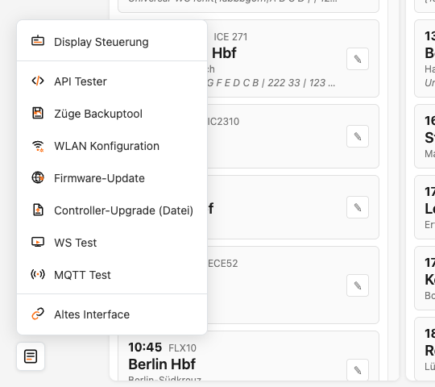
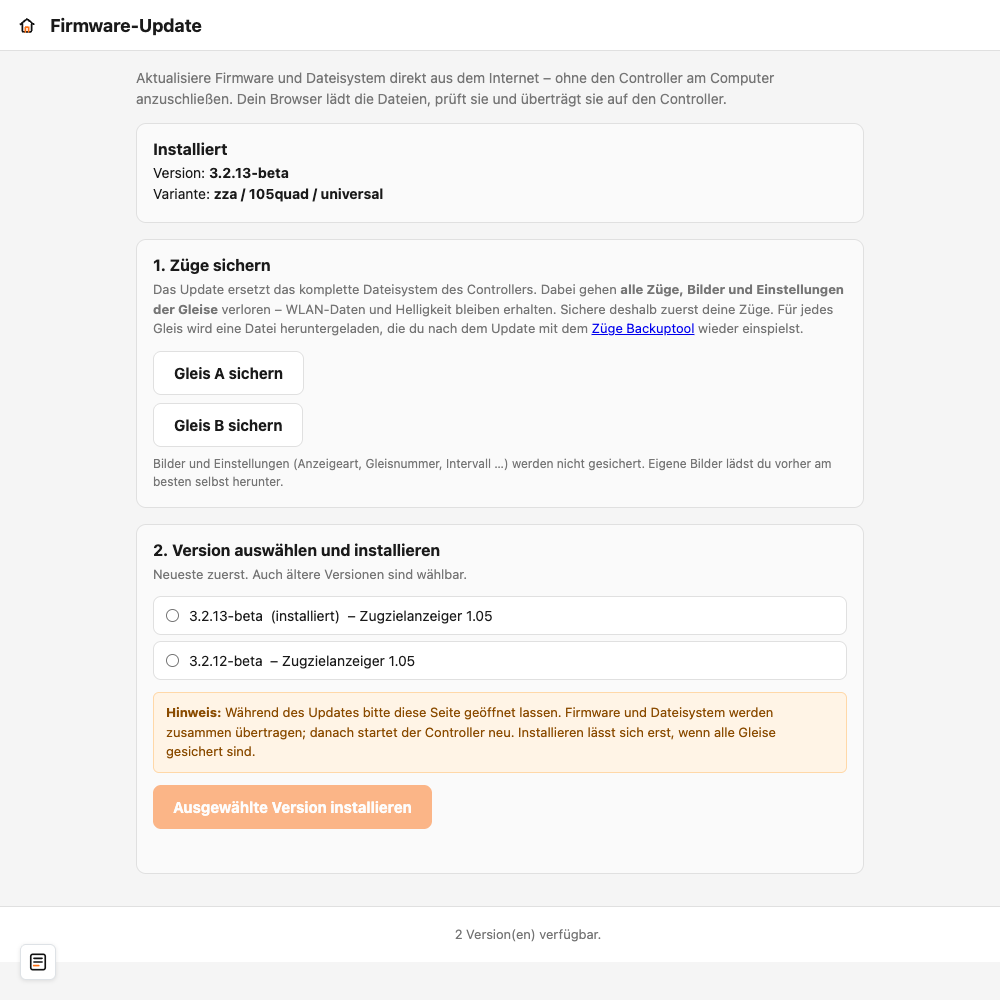
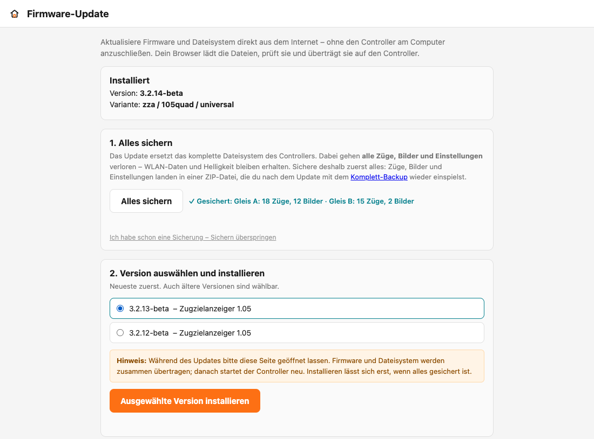
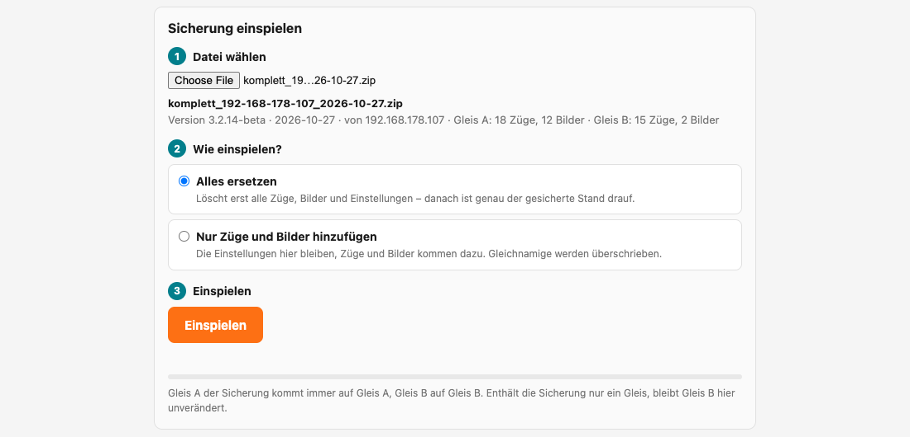
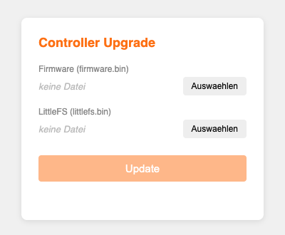
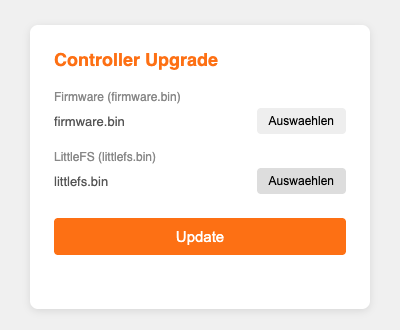
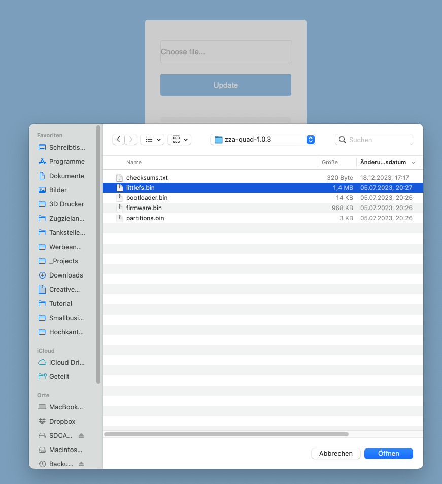
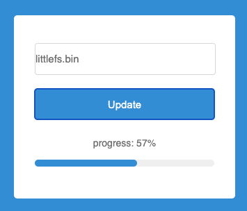
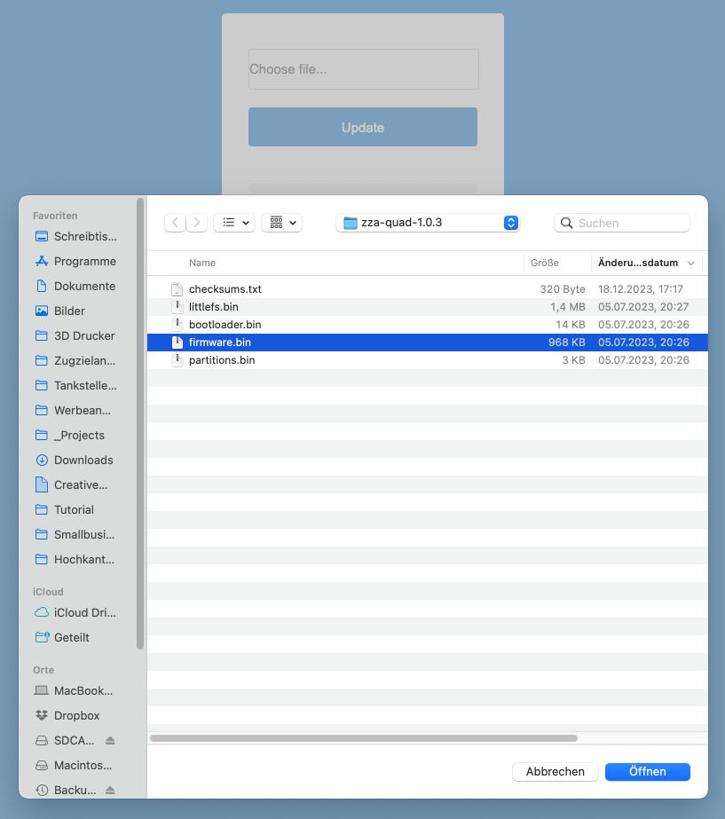

# Controller aktualisieren (über WLAN)

Von Zeit zu Zeit gibt es eine neue Firmware für deinen Controller — mit neuen Funktionen oder Fehlerbehebungen. Die Firmware ist das Programm, das im Controller läuft. Diese Anleitung zeigt dir, wie du sie bequem über dein Heim-WLAN und den Browser aktualisierst. Du brauchst dafür kein Kabel — nur ein Gerät, das im selben WLAN hängt wie dein Display.

## Inhalt
{: .no_toc .text-delta }

- TOC
{:toc}

---

## Welcher Weg für dich gilt

Es gibt vier Wege, die Firmware zu aktualisieren. Welcher für dich passt, hängt davon ab, welche Firmware gerade auf deinem Controller läuft:

| Weg | Wann | Was du brauchst |
|---|---|---|
| **1. Firmware-Update aus dem Internet** | Dein Controller hat die Seite **Firmware-Update** schon (Versionen siehe unten) | Ein Gerät im selben WLAN, dessen Browser ins Internet kommt |
| **2. Update mit heruntergeladenen Dateien — beide auf einmal** | Die Seite `/ota` deines Controllers hat **zwei** Dateifelder | Einen Computer im selben WLAN und die Firmware-Dateien von der Download-Seite |
| **3. Update mit heruntergeladenen Dateien — nacheinander** | Die Seite `/ota` deines Controllers hat nur **ein** Dateifeld (ältere Firmware) | Einen Computer im selben WLAN und die Firmware-Dateien von der Download-Seite |
| **4. Update per USB** | Der Controller ist über WLAN nicht mehr erreichbar, oder die anderen Wege klappen nicht | Einen Windows-PC und ein USB-C-Kabel, siehe [Controller aktualisieren (per USB)](controller-aktualisieren-usb.md) |

**Hat dein Controller die Seite Firmware-Update, nimm immer Weg 1.** Du musst dabei nichts herunterladen, entpacken oder auswählen: Die Seite zeigt dir, welche Versionen es für genau deinen Controller gibt, und spielt die gewählte mit einem Klick ein. Eine falsche Datei für eine andere Display-Variante kann so nicht passieren.

Die Seite **Firmware-Update** gibt es ab diesen Versionen:

| Display | Firmware-Update aus dem Internet ab | So heißt der Menüpunkt |
|---|---|---|
| Zugzielanzeiger (1,05") | 3.2.12 | **Firmware-Update** |
| Tankstellenanzeige | 3.0 | **Firmware-Update** |
| Video-Display | 3.0 | **Firmware-Update (Online)** |

Welche Version auf deinem Controller läuft, siehst du, wenn du kurz **BTN 0** drückst: Die Versionsnummer steht unten rechts auf dem Display. Am einfachsten schaust du aber ins Menü (☰) der Weboberfläche — steht dort der Menüpunkt aus der Tabelle, geht Weg 1.

Gibt es den Menüpunkt nicht, öffnest du die Seite `/ota` (wie, steht bei [Weg 2](#weg-2-update-mit-heruntergeladenen-dateien--beide-auf-einmal)). Hat sie zwei Dateifelder, nimmst du Weg 2, hat sie nur eines, Weg 3.

> **Hinweis:** Läuft auf deinem Controller eine ältere Version, aktualisierst du ihn **einmal** mit Weg 2 oder 3. Danach hat er die Seite Firmware-Update, und alle weiteren Updates gehen über Weg 1.

 OFFEN-33: Versionen in der Tabelle prüfen. Tankstelle: update.htm im Code ab 3.0.9, online erste Version 3.0.12 — stimmt „ab 3.0“? Video: update.htm im Code ab 3.0.1, online 3.0.5 — stimmt „ab 3.0“, und ist 3.0.5 wirklich mit update.htm gebaut? Menüname Video „Firmware-Update (Online)“ aus dem Code (Branch feature/multicore-videomode-webserver), die Video-Inbetriebnahme nennt „Firmware-Update“. BTN 0 zeigt die Version — gilt das für Tankstelle und Video? 

---

## Weg 1: Firmware-Update aus dem Internet

Bei diesem Weg lädt dein Browser die neue Firmware direkt von modellbahn-displays.de, prüft, ob die Dateien unbeschädigt angekommen sind, und überträgt sie an den Controller. Der Controller selbst muss dafür nicht ins Internet.

### Was du brauchst

- Ein Smartphone, Tablet oder einen Computer, der **im selben WLAN** hängt wie dein Display **und** ins Internet kommt — dein Browser holt die Firmware aus dem Internet und reicht sie an den Controller weiter
- Bei einem Zugzielanzeiger: ein paar Minuten, um vorher alles zu sichern (das macht die Seite für dich)

Der Controller selbst braucht dafür **keinen** Internetzugang.

> **Tipp:** Meldet die Seite, dass der Update-Server nicht erreichbar ist, kommt dein Browser nicht ins Internet. Das passiert zum Beispiel, wenn du mit dem Hotspot des Controllers (`MoBaDi-…`) verbunden bist und dein Gerät daneben kein Mobilfunk-Internet nutzt. Verbinde dich dann mit deinem Heim-WLAN.

### Seite öffnen

Öffne die Weboberfläche deines Displays im Browser, klicke unten links auf das Menü (☰) und wähle **Firmware-Update**. Beim Zugzielanzeiger und bei der Tankstellenanzeige gibt es dafür auch einen Knopf auf der Startseite.

{: style="max-width: 50%;" }

Du erreichst die Seite auch direkt über die Adresszeile: die IP-Adresse deines Controllers, gefolgt von `/update.htm`, zum Beispiel:

```
http://192.168.178.41/update.htm
```

Oben unter **Installiert** siehst du die Version, die gerade läuft, und die Variante deines Controllers.

{: style="max-width: 80%;" }

### Schritt 1: Alles sichern (nur Zugzielanzeiger)

Das Update ersetzt das komplette Dateisystem des Controllers — dabei gehen **alle Züge, Bilder und Einstellungen** verloren. Deine WLAN-Daten und die eingestellte Helligkeit bleiben erhalten.

Wie du sicherst, hängt von der Version ab, die **gerade** auf deinem Controller läuft — sie steht oben unter **Installiert**.

#### Ab Version 3.2.14

1. Klicke auf **Alles sichern**. Die Seite lädt Züge, Bilder und Einstellungen aller Gleise und speichert sie zusammen als eine ZIP-Datei, zum Beispiel `komplett_192-168-178-41_2026-10-27.zip`. Eine ZIP-Datei ist ein Paket, das mehrere Dateien zusammenfasst.
2. Neben dem Knopf erscheint dann zum Beispiel **✓ Gesichert: Gleis A: 18 Züge, 12 Bilder · Gleis B: 15 Züge, 2 Bilder**.

> **Hinweis:** Je nach Einstellung deines Browsers fragt er beim Download, wo die Datei gespeichert werden soll. Wähle einen Ordner, in dem du sie wiederfindest — du brauchst sie nach dem Update.

Hast du gerade erst eine Sicherung gemacht, zum Beispiel mit dem [Komplett-Backup](../zugzielanzeiger/backup.md#komplettes-backup--alles-in-einer-datei), klicke stattdessen auf den kleinen Link **Ich habe schon eine Sicherung – Sichern überspringen**. Neben dem Knopf steht dann **Sichern übersprungen**.

> **Wichtig:** Überspringe das Sichern nur, wenn deine Sicherung den **aktuellen** Stand enthält. Alles, was danach dazugekommen ist, ist nach dem Update weg.

#### Bis Version 3.2.13

Hier sichert die Seite nur die Züge, für jedes Gleis in eine eigene Datei.

1. Klicke auf **Gleis A sichern**. Die Seite liest alle Züge des Gleises und lädt sie als eine Datei herunter, zum Beispiel `backup_192-168-178-41_GleisA_2026-10-25.json`. Neben dem Knopf erscheint dann zum Beispiel **✓ 52 Züge gesichert**.
2. Beim Zugzielanzeiger für zwei Gleise klickst du danach auf **Gleis B sichern**.

{: style="max-width: 80%;" }

Bilder und die Einstellungen der Gleise (Anzeigeart, Gleisnummer, Intervall …) sichert diese Seite nicht. Eigene Bilder lädst du vorher am besten selbst herunter, und die Einstellungen notierst du dir, siehe [Einstellungen und Bilder von Hand sichern](../zugzielanzeiger/backup.md#einstellungen-und-bilder-von-hand-sichern-bis-version-3213).

 OFFEN-34: Was geht bei Tankstelle und Video beim Online-Update verloren (Dateisystem wird ersetzt)? Deren Update-Seite hat keinen Sicherungsschritt und keinen Hinweis — muss der Leser dort vorher etwas sichern? 

### Schritt 2: Version auswählen und installieren

1. Unter **Version auswählen und installieren** stehen alle Versionen, die es für deinen Controller gibt — die neueste oben. Die Version, die gerade läuft, ist mit **(installiert)** markiert. Wähle die neueste Version aus.
2. Klicke auf **Ausgewählte Version installieren**. Beim Zugzielanzeiger geht der Knopf erst, wenn du in Schritt 1 gesichert (oder das Sichern übersprungen) hast.
   {: style="max-width: 80%;" }
3. Bestätige die Rückfrage mit **OK**.
4. Die Seite lädt jetzt die Firmware, prüft sie und überträgt sie an den Controller. Lass die Seite dabei geöffnet und schalte den Controller nicht aus.
5. Ist alles übertragen, startet der Controller von selbst neu — jetzt mit der neuen Firmware. Die Seite zeigt **Übertragen. Controller startet neu…** und zählt die Sekunden mit. Ist er wieder da, steht dort zum Beispiel **Update fertig – Version 3.2.14-beta läuft.**, darunter die Knöpfe für den nächsten Schritt.

> **Hinweis:** Bis Version 3.2.13 bleibt die Anzeige nach dem Übertragen bei **Dateisystem übertragen… 100%** stehen. Das Update läuft trotzdem: Warte etwa eine Minute, dann ist der Controller neu gestartet.

> **Tipp:** Auch ältere Versionen sind in der Liste wählbar. Läuft eine neue Version bei dir nicht so wie gewünscht, kannst du so auf die vorherige zurückgehen.

### Schritt 3: Sicherung wieder einspielen (nur Zugzielanzeiger)

Nach dem Neustart zeigt der Zugzielanzeiger die Beispielzüge, die mit der Firmware kommen. Deine eigenen Daten spielst du jetzt wieder ein. Lade vorher die Weboberfläche einmal neu, damit dein Browser nicht noch die alten Seiten zeigt (siehe [Nach dem Update: Seite neu laden](#nach-dem-update-seite-neu-laden)).

#### Hast du in Schritt 1 alles gesichert (ab Version 3.2.14)

1. Klicke unter der Meldung **Update fertig** auf **Sicherung einspielen**. Es öffnet sich das **Komplett-Backup**, gleich beim Einspielen. Du findest es auch im Menü (☰) unter **Komplett-Backup**
2. Klicke unter **Datei wählen** auf **Datei auswählen** und wähle die ZIP-Datei aus Schritt 1
3. Lass unter **Wie einspielen?** die Einstellung **Alles ersetzen** stehen und klicke auf **Einspielen**. Bestätige die Rückfrage
4. Die Seite überträgt alles und startet den Controller neu. Am Ende steht zum Beispiel **Fertig: 50 Dateien eingespielt.**

{: style="max-width: 80%;" }

Damit sind Züge, Bilder und Einstellungen wieder da, und die Beispielzüge sind verschwunden. Ausführlich steht das unter [Sicherung einspielen](../zugzielanzeiger/backup.md#sicherung-einspielen).

#### Hast du in Schritt 1 nur die Züge gesichert (bis Version 3.2.13)

1. Öffne die Weboberfläche und wähle im Menü (☰) **Züge Backuptool**. Das Backuptool verbindet sich von selbst mit dem Controller.
2. Wähle unter **Restore** bei **Choose file** die Sicherungsdatei von Gleis A aus.
3. Prüfe, dass darunter **Gleis A** gewählt ist, und klicke auf **Wiederherstellen**. Am Ende steht dort zum Beispiel **Fertig: 52 gespeichert**.
4. Beim Zugzielanzeiger für zwei Gleise wiederholst du das mit der Datei von Gleis B und **Gleis B**.

{: style="max-width: 80%;" }

Ausführlich steht das unter [Sichern und wiederherstellen](../zugzielanzeiger/backup.md). Zum Schluss stellst du die Einstellungen der Gleise wieder ein.

 OFFEN-35: Die Beispielzüge aus der Firmware bleiben nach dem Wiederherstellen zusätzlich in der Liste, wenn sie nicht in der Sicherung waren. Erwähnen, wie man sie loswird? 

---

## Weg 2: Update mit heruntergeladenen Dateien — beide auf einmal

Diesen Weg nimmst du, wenn dein Controller die Seite Firmware-Update noch nicht hat, seine Seite `/ota` aber **zwei** Dateifelder zeigt. Das ist beim Zugzielanzeiger ab Firmware 3.0 und bei der Tankstellenanzeige so. Du lädst die Firmware selbst herunter und gibst beide Dateien in einem Durchgang an den Controller.

### Was du vorher wissen solltest

Der Speicher des Controllers ist in zwei Bereiche aufgeteilt:

- **Firmware** (Datei `firmware.bin`) — das eigentliche Programm des Controllers
- **Dateisystem** (Datei `littlefs.bin`) — hier liegen die Webseiten des Webinterfaces und deine Einstellungen

Auf der Seite `/ota` wählst du beide Dateien aus, und die Seite überträgt sie nacheinander. Der Controller startet erst neu, wenn beide angekommen sind.

> **Achtung:** Das neue Dateisystem ersetzt das alte komplett. Beim Zugzielanzeiger gehen dabei **alle Züge, Bilder und Einstellungen der Gleise** verloren. Sichere vorher alles mit dem Komplett-Backup (ab Version 3.2.14) — oder bei älteren Versionen deine Züge mit dem Züge Backuptool und notiere dir deine Einstellungen. Beides steht unter [Sichern und wiederherstellen](../zugzielanzeiger/backup.md).

 OFFEN-36: Bleiben die WLAN-Daten bei Weg 2 erhalten? Zugzielanzeiger, Tankstelle und Video speichern sie auf den S3-Controllern im EEPROM, nicht im Dateisystem — beim Online-Update (gleicher Upload-Weg /doUpdate) blieben sie nachweislich erhalten (ZZA 3.2.13-beta getestet). Dann hier ausdrücklich sagen „WLAN bleibt“. Und: Was geht bei der Tankstelle verloren? 

### Was du brauchst

- Einen Computer (Windows-PC oder Mac), der **im selben WLAN** hängt wie dein Display. Mit Smartphone oder Tablet nimmst du diesen Weg besser nicht — das Entpacken der Firmware ist dort umständlich.
- Die heruntergeladene und entpackte Firmware (siehe nächster Abschnitt)

### Firmware herunterladen und entpacken

1. Öffne die Firmware-Seite: [modellbahn-displays.de/firmware](https://www.modellbahn-displays.de/firmware/)
2. Dort sind die Firmware-Pakete nach Display, Controller und Variante sortiert, die neueste Version steht jeweils oben. Klicke bei deinem Display auf **ZIP**. Du bekommst eine ZIP-Datei (ein zusammengepacktes Archiv mit mehreren Dateien).
3. Entpacke das ZIP-Archiv. Unter Windows klickst du es mit der rechten Maustaste an und wählst **Alle extrahieren**, am Mac genügt ein Doppelklick.

> **Hinweis:** Achte darauf, dass du die Firmware für genau deine Display-Variante lädst — beim Zugzielanzeiger zum Beispiel **Einzelgleis** oder **Doppelgleis**. Im Zweifel schau auf deiner Bestellbestätigung nach oder frag kurz nach.

Im entpackten Ordner findest du mehrere Dateien, zum Beispiel `checksums.txt`, `bootloader.bin` und `partitions.bin`. Davon brauchst du nur diese beiden:

- `firmware.bin`
- `littlefs.bin`

Die übrigen Dateien lässt du einfach liegen.

### Update-Seite im Browser öffnen

Du brauchst die IP-Adresse deines Controllers — eine Art Hausnummer im Heimnetzwerk. Drücke kurz die Taste **BTN 0** am Controller, dann wird sie auf dem Display angezeigt (z.B. `192.168.178.41`). Ausführlich steht das unter [IP-Adresse herausfinden](wlan-einrichten.md#ip-adresse-herausfinden).

Am einfachsten kommst du über das Webinterface hin: Öffne die Startseite deines Displays im Browser und klicke auf **Controller-Upgrade**.

> **Hinweis:** Hat dein Controller schon die Seite Firmware-Update (siehe [Welcher Weg für dich gilt](#welcher-weg-für-dich-gilt)), steht auf der Startseite stattdessen der Knopf für Weg 1. Die Seite für das Update mit heruntergeladenen Dateien findest du dann im Menü (☰) unter **Controller-Upgrade (Datei)**.

Du erreichst die Seite auch direkt über die Adresszeile — das funktioniert unabhängig davon, wie das Menü gerade aufgebaut ist. Gib dazu die Adresse deines Controllers ein, gefolgt von `/ota`:

```
http://192.168.178.41/ota
```

Setze statt `192.168.178.41` natürlich die IP-Adresse deines eigenen Controllers ein.

Steht oben **Controller Upgrade** und gibt es die zwei Felder **Firmware (firmware.bin)** und **LittleFS (littlefs.bin)**, bist du hier richtig. Gibt es nur ein Feld **Choose file…**, geht es bei [Weg 3](#weg-3-update-mit-heruntergeladenen-dateien--nacheinander) weiter.

{: style="max-width: 40%;" }

 OFFEN-37: Seite mit zwei Feldern beim ZZA ab 3.0.2-beta und bei der Tankstelle ab ca. 2.0 (im Code), beim Video-Display (3.0.5) noch die alte Seite mit einem Feld — so richtig zugeordnet? Gibt es bei der Seite mit zwei Feldern den WLAN-Zwischenschritt? Dort startet der Controller erst nach beiden Dateien neu. 

### Update einspielen

1. Klicke bei **Firmware (firmware.bin)** auf **Auswaehlen** und wähle die Datei `firmware.bin` aus dem entpackten Ordner.
2. Klicke bei **LittleFS (littlefs.bin)** auf **Auswaehlen** und wähle die Datei `littlefs.bin`.
   {: style="max-width: 40%;" }
3. Klicke auf **Update**. Die Seite lädt erst die Firmware, dann das Dateisystem hoch und zeigt dabei jeweils einen Fortschrittsbalken.
4. Steht dort **Update erfolgreich. Geraet startet neu...**, startet der Controller von selbst neu. Nach etwa 20 Sekunden springt die Seite zurück zur Startseite.

> **Hinweis:** Die Seite nimmt nur Dateien mit genau diesen Namen an. Hat dein Browser beim Herunterladen etwas angehängt (zum Beispiel `firmware (1).bin`), meldet sie **Falscher Dateiname**. Benenne die Datei dann um oder lade die Firmware noch einmal herunter.

Fertig. Wenn auf dem Display wieder das Startbild erscheint und die LED grün leuchtet, ist das Update abgeschlossen. Lade die Weboberfläche danach einmal neu (siehe [Nach dem Update: Seite neu laden](#nach-dem-update-seite-neu-laden)). Beim Zugzielanzeiger spielst du danach deine Sicherung wieder ein, wie bei [Weg 1, Schritt 3](#schritt-3-sicherung-wieder-einspielen-nur-zugzielanzeiger).

---

## Weg 3: Update mit heruntergeladenen Dateien — nacheinander

Diesen Weg nimmst du bei älterer Firmware, deren Seite `/ota` nur **ein** Dateifeld **Choose file…** hat. Du lädst die beiden Dateien dann in zwei Durchgängen hoch.

### Was du vorher wissen solltest

Der Speicher des Controllers ist in zwei Bereiche aufgeteilt, die **getrennt voneinander** aktualisiert werden:

- **Dateisystem** (Datei `littlefs.bin`) — hier liegen die Webseiten des Webinterfaces und deine Einstellungen
- **Firmware** (Datei `firmware.bin`) — das eigentliche Programm des Controllers

Du lädst also nacheinander **zwei Dateien** hoch. Halte diese Reihenfolge unbedingt ein: erst das Dateisystem, dann die Firmware.

> **Achtung:** Beim Aktualisieren des Dateisystems werden **alle Einstellungen zurückgesetzt** — auch deine WLAN-Zugangsdaten. Notiere dir vorher deine wichtigsten Einstellungen. Je nach Display und Firmware-Version gibt es im Webinterface auch eine Sicherungs-Funktion, mit der du deine Konfiguration vorher als Datei speichern und hinterher wieder einspielen kannst.

### Was du brauchst

- Einen Computer (Windows-PC oder Mac), der **im selben WLAN** hängt wie dein Display. Mit Smartphone oder Tablet nimmst du diesen Weg besser nicht — das Entpacken der Firmware ist dort umständlich.
- Die heruntergeladene und entpackte Firmware (siehe nächster Abschnitt)

### Firmware herunterladen und entpacken

1. Öffne die Firmware-Seite: [modellbahn-displays.de/firmware](https://www.modellbahn-displays.de/firmware/)
2. Dort sind die Firmware-Pakete nach Display, Controller und Variante sortiert, die neueste Version steht jeweils oben. Klicke bei deinem Display auf **ZIP**. Du bekommst eine ZIP-Datei (ein zusammengepacktes Archiv mit mehreren Dateien).
3. Entpacke das ZIP-Archiv. Unter Windows klickst du es mit der rechten Maustaste an und wählst **Alle extrahieren**, am Mac genügt ein Doppelklick.

> **Hinweis:** Achte darauf, dass du die Firmware für genau deine Display-Variante lädst — bei manchen Displays gibt es mehrere Ausführungen (z.B. Einzelgleis und Doppelgleis). Die Bezeichnung steht im Dateinamen des Downloads. Im Zweifel schau auf deiner Bestellbestätigung nach oder frag kurz nach.

Im entpackten Ordner findest du mehrere Dateien, zum Beispiel `checksums.txt`, `bootloader.bin` und `partitions.bin`. Davon brauchst du nur diese beiden:

- `littlefs.bin`
- `firmware.bin`

Die übrigen Dateien lässt du einfach liegen.

### Update-Seite im Browser öffnen

Du brauchst die IP-Adresse deines Controllers — eine Art Hausnummer im Heimnetzwerk. Drücke kurz die Taste **BTN 0** am Controller, dann wird sie auf dem Display angezeigt (z.B. `192.168.178.41`). Ausführlich steht das unter [IP-Adresse herausfinden](wlan-einrichten.md#ip-adresse-herausfinden).

Am einfachsten kommst du über das Webinterface hin: Öffne die Startseite deines Displays im Browser und klicke auf **Controller-Upgrade** (beim Video-Display heißt der Knopf **Firmware aktualisieren**).

Du erreichst die Seite auch direkt über die Adresszeile — das funktioniert unabhängig davon, wie das Menü gerade aufgebaut ist. Gib dazu die Adresse deines Controllers ein, gefolgt von `/ota`:

```
http://192.168.178.41/ota
```

Setze statt `192.168.178.41` natürlich die IP-Adresse deines eigenen Controllers ein.

### Schritt 1: Dateisystem aktualisieren

1. Klicke auf der Update-Seite auf das Feld **Choose file…** und wähle die Datei `littlefs.bin` aus dem entpackten Ordner aus.
   {: style="max-width: 70%;" }
2. Klicke auf **Update**. Der Upload startet, und du siehst einen Fortschrittsbalken mit Prozentanzeige.
   {: style="max-width: 50%;" }
3. Warte, bis der Balken 100 % erreicht hat. Der Controller startet danach von selbst neu.

> **Hinweis:** Schalte den Controller während des Updates auf keinen Fall aus und schließe den Browser-Tab nicht. Warte auch dann ab, wenn die Seite kurz nicht mehr reagiert — das ist normal.

### Zwischenschritt: WLAN neu einrichten

Weil beim Dateisystem-Update auch die WLAN-Zugangsdaten gelöscht wurden, ist der Controller jetzt **nicht mehr in deinem Heim-WLAN**. Er öffnet stattdessen wieder sein eigenes Netzwerk.

**Bevor du mit Schritt 2 weitermachen kannst, musst du das WLAN neu einrichten** — wie das geht, steht unter [WLAN einrichten](wlan-einrichten.md). Erst danach ist der Controller wieder über dein Heim-WLAN erreichbar.

> **Hinweis:** Nach der Neueinrichtung kann der Controller eine **andere IP-Adresse** haben als vorher. Drücke deshalb noch einmal kurz **BTN 0** und notiere dir die neu angezeigte Adresse.

### Schritt 2: Firmware aktualisieren

1. Rufe die Update-Seite erneut auf — also noch einmal die IP-Adresse deines Controllers gefolgt von `/ota`, zum Beispiel `http://192.168.178.41/ota`
2. Klicke wieder auf **Choose file…**, diesmal wählst du die Datei `firmware.bin` aus.
   {: style="max-width: 70%;" }
3. Klicke auf **Update** und warte wieder, bis der Fortschrittsbalken durchgelaufen ist.
4. Der Controller startet neu — jetzt mit der neuen Firmware.

### Nach dem Update

Fertig. Wenn auf dem Display wieder das Startbild erscheint und die LED grün leuchtet, ist das Update abgeschlossen.

> **Tipp:** Bei neueren Firmware-Versionen wird die installierte Versionsnummer im Webinterface angezeigt. Dort kannst du nachsehen, ob wirklich die neue Version läuft. Bei älteren Versionen gibt es diese Anzeige noch nicht.

Zum Schluss lädst du die Weboberfläche einmal neu (siehe [Nach dem Update: Seite neu laden](#nach-dem-update-seite-neu-laden)) und richtest deine Einstellungen wieder ein, die beim Dateisystem-Update zurückgesetzt wurden.

---

## Weg 4: Update per USB

Ist der Controller über WLAN nicht mehr erreichbar oder klappt keiner der anderen Wege, aktualisierst du ihn per USB-C-Kabel an einem Windows-PC. Wie das geht, steht in einer eigenen Anleitung: [Controller aktualisieren (per USB)](controller-aktualisieren-usb.md).

---

## Nach dem Update: Seite neu laden

Dein Browser merkt sich Teile von Webseiten, die er schon einmal geladen hat, damit sie beim nächsten Mal schneller erscheinen. Dieser Zwischenspeicher heißt **Cache**. Nach einem Update kann es deshalb passieren, dass der Browser noch die alte Weboberfläche zeigt, obwohl auf dem Controller schon die neue läuft — oder eine Mischung aus alt und neu. Typische Anzeichen:

- Neue Menüpunkte oder Knöpfe fehlen
- Die angezeigte Versionsnummer ist noch die alte
- Knöpfe reagieren nicht oder Seiten bleiben leer

Das gilt für alle vier Wege, also auch nach einem Update per USB. So holst du die neuen Seiten vom Controller:

| Browser | So lädst du die Seite ohne Cache neu |
|---|---|
| Chrome, Edge, Firefox unter Windows | **Strg + F5** oder **Strg + Umschalt + R** |
| Chrome, Edge, Firefox am Mac | **Cmd + Umschalt + R** |
| Safari am Mac | **Cmd + Wahl + R** |

Mach das auf jeder Seite der Weboberfläche, die du nach dem Update öffnest und die noch alt aussieht — zum Beispiel auch im **Züge Backuptool**.

> **Tipp:** Auf Smartphone und Tablet gibt es keine solche Tastenkombination. Öffne die Weboberfläche dort am einfachsten in einem privaten Tab (in Safari **Privat**, in Chrome **Inkognito**) — der benutzt den Cache nicht. Hilft das alles nicht, lösche in den Einstellungen deines Browsers die gespeicherten Bilder und Dateien („Browserdaten löschen“).

---

## Problembehebung

| Problem | Lösung |
|---|---|
| Im Menü gibt es keinen Punkt **Firmware-Update** | Die Firmware auf deinem Controller ist älter. Aktualisiere ihn einmal mit [Weg 2](#weg-2-update-mit-heruntergeladenen-dateien--beide-auf-einmal) oder [Weg 3](#weg-3-update-mit-heruntergeladenen-dateien--nacheinander) |
| Firmware-Update: **Update-Server nicht erreichbar – Gerät unverändert.** | Der Browser auf deinem Smartphone, Tablet oder Computer kommt nicht ins Internet — zum Beispiel, weil es nur mit dem Hotspot des Controllers verbunden ist. Verbinde es mit deinem Heim-WLAN und lade die Seite neu |
| Firmware-Update: **Keine passenden Versionen gefunden.** | Für deinen Controller liegt noch keine Version zum Online-Update bereit. Nimm [Weg 2](#weg-2-update-mit-heruntergeladenen-dateien--beide-auf-einmal) |
| Firmware-Update: **Installieren** lässt sich nicht anklicken | Beim Zugzielanzeiger musst du erst sichern: ab Version 3.2.14 mit **Alles sichern** (oder **Sichern überspringen**), bis 3.2.13 jedes Gleis einzeln. Prüfe außerdem, ob eine Version ausgewählt ist |
| Firmware-Update: Meldung **Prüfsumme stimmt nicht** | Die Datei ist beim Herunterladen beschädigt worden. Auf den Controller wurde nichts übertragen. Lade die Seite neu und starte das Update noch einmal |
| Update-Seite lässt sich nicht öffnen | Drücke **BTN 0** am Controller und prüfe die angezeigte IP-Adresse. Achte darauf, dass `http://` und nicht `https://` davorsteht |
| Weg 3: Nach dem Dateisystem-Update ist der Controller nicht mehr erreichbar | Das ist normal — die WLAN-Daten wurden gelöscht. Richte das WLAN neu ein, siehe [WLAN einrichten](wlan-einrichten.md) |
| Nach dem Update sieht die Weboberfläche noch aus wie vorher, Knöpfe fehlen oder reagieren nicht | Dein Browser zeigt noch die alten Seiten aus seinem Cache. Lade die Seite ohne Cache neu, siehe [Nach dem Update: Seite neu laden](#nach-dem-update-seite-neu-laden) |
| Upload bricht ab oder bleibt stehen | Gehe mit dem Smartphone oder Computer näher an den Router und starte den Upload erneut. Bei schlechtem WLAN-Empfang brechen Uploads häufig ab |
| Display bleibt nach dem Update dunkel | Trenne den Controller kurz von der Stromversorgung und schalte ihn wieder ein. Hilft das nicht, spiele die Firmware per USB neu auf, siehe [Controller aktualisieren (per USB)](controller-aktualisieren-usb.md) |
| Update über WLAN klappt gar nicht | Aktualisiere den Controller stattdessen per USB-Kabel am PC, siehe [Controller aktualisieren (per USB)](controller-aktualisieren-usb.md) |
