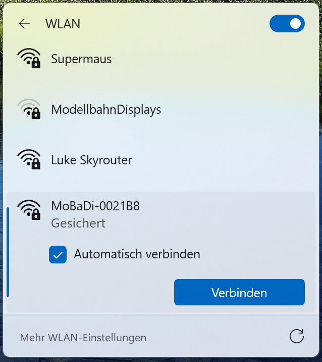
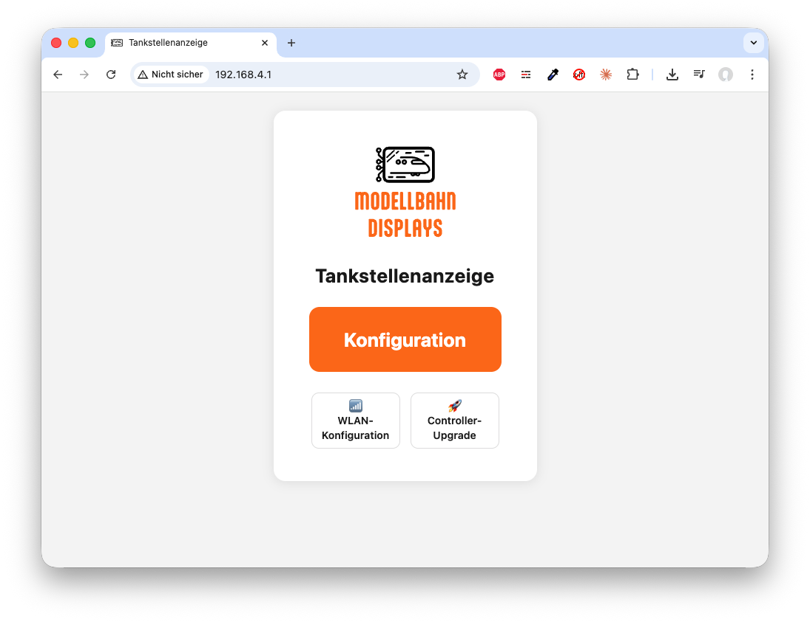
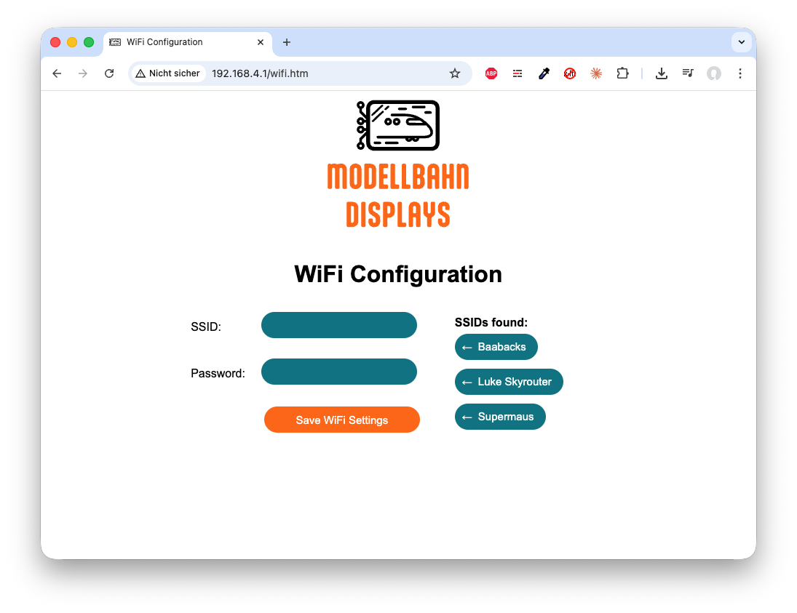
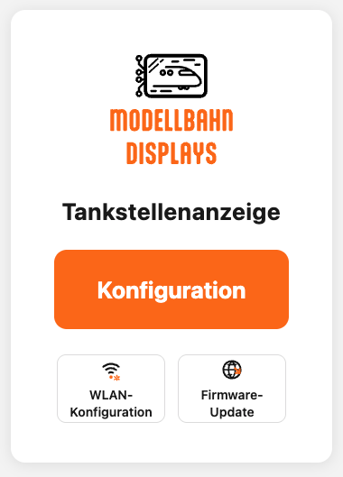

# WLAN einrichten

Diese Anleitung beschreibt, wie du dein Display mit deinem Heim-WLAN verbindest. Die Schritte sind bei allen Displays gleich.

> **Hinweis:** Mit der Betriebssoftware (Firmware) **3.2** hat sich die WLAN-Einrichtung geändert. Deshalb gibt es auf dieser Seite zwei Abschnitte: [Ab Firmware 3.2](#ab-firmware-32) und [Bis Firmware 3.1](#bis-firmware-31). Welche Version dein Display hat, steht in der Anleitung zu deinem Display.

## Inhalt
{: .no_toc .text-delta }

- TOC
{:toc}

---

## So funktioniert die WLAN-Einrichtung

Beim ersten Einschalten (oder wenn keine WLAN-Daten gespeichert sind) erstellt dein Display ein eigenes WLAN-Netzwerk, einen sogenannten **Hotspot**. Die Zugangsdaten werden auf dem Display angezeigt, wenn du kurz die Taste **BTN 0** am Controller drückst:

- **WLAN-Name:** MoBaDi-XXXXXX (die Zeichen sind bei jedem Controller anders)
- **Passwort:** MoBaDi_XXXXXX

---

## Ab Firmware 3.2

### Einrichten Schritt für Schritt

1. Verbinde dich mit deinem Smartphone oder Computer mit dem WLAN deines Displays (Name und Passwort stehen auf dem Display). Unter Windows findest du die WLAN-Auswahl in der Taskleiste:
   {: style="max-width: 50%;" }
2. Öffne einen Browser (z.B. Chrome, Safari oder Firefox) und gib oben in die Adressleiste `192.168.4.1` ein. Du siehst die Startseite des Webinterfaces (die Einstellungsseite deines Displays im Browser).
3. Klicke auf **WLAN-Konfiguration**. Die Seite heißt **WiFi Configuration** und hat zwei Bereiche: **WiFi 1** und **WiFi 2**. Für dein Heim-WLAN nimmst du **WiFi 1**.
    Screenshot der neuen WLAN-Seite (WiFi 1 / WiFi 2) fehlt noch. 
4. Rechts unter **SSIDs found** (gefundene WLAN-Netzwerke) werden die verfügbaren Netzwerke angezeigt. Klicke auf dein Heim-WLAN — der Name wird automatisch in das Feld **SSID** übernommen.
5. Gib im Feld **Password** das Passwort deines WLANs ein.
6. Klicke auf **Save WiFi 1**.
7. Unter den Eingabefeldern steht jetzt **Saved. Connecting to …** — das Display versucht, sich mit deinem WLAN zu verbinden. Das dauert einige Sekunden. Das Display startet dabei nicht neu, und sein eigenes WLAN bleibt währenddessen an.
8. Hat es geklappt, steht dort **Connected to …** und darunter die neue Adresse des Displays in deinem Heim-WLAN, zum Beispiel `http://192.168.178.41/`. Notiere sie dir.
9. Verbinde dein Smartphone oder deinen Computer wieder mit deinem Heim-WLAN. Danach erreichst du das Display unter der neuen Adresse. Sein eigenes WLAN schaltet es nach etwa einer halben Minute ab.

> **Tipp:** Steht dort **Could not connect to …**, stimmt meist das Passwort nicht. Prüfe Name und Passwort und klicke noch einmal auf **Save WiFi 1**.

> **Hinweis:** Steht dort **Lost contact with the device**, hat sich das Display meistens gerade mit deinem WLAN verbunden und sein eigenes abgeschaltet, bevor die Seite die Adresse anzeigen konnte. Verbinde dich wieder mit deinem Heim-WLAN und lies die Adresse wie unter [IP-Adresse herausfinden](#ip-adresse-herausfinden) beschrieben am Display ab.

> **Hinweis:** Falls dein WLAN nicht in der Liste auftaucht, kannst du den Netzwerknamen (SSID) auch von Hand in das Eingabefeld eintippen. Die Liste wird nicht automatisch aktualisiert.

### Ein zweites WLAN hinterlegen

Unter **WiFi 2** kannst du ein zweites WLAN eintragen — zum Beispiel das WLAN im Vereinsheim oder auf einer Ausstellung. Das Display versucht beim Verbinden immer zuerst **WiFi 1**. Klappt das nicht, nimmt es **WiFi 2**.

Du trägst es genauso ein wie das erste: Klicke in eines der Felder unter **WiFi 2**, wähle rechts das Netzwerk aus, gib das Passwort ein und klicke auf **Save WiFi 2**. Mit **Delete** löschst du das zweite WLAN wieder.

> **Hinweis:** Beim Speichern probiert das Display nur das WLAN aus, das du gerade eingetragen hast. Ist das zweite WLAN gerade nicht in Reichweite — weil du es zum Beispiel zu Hause für die nächste Ausstellung einträgst —, erscheint **Could not connect to …**. Gespeichert ist es trotzdem.

### Wenn dein WLAN nicht erreichbar ist

Findet das Display beim Einschalten keines seiner gespeicherten WLANs — weil zum Beispiel der Router aus ist oder du mit der Anlage auf einer Ausstellung bist —, öffnet es wieder sein eigenes WLAN. Das dauert nach dem Einschalten bis zu 15 Sekunden, mit zwei gespeicherten WLANs bis zu einer halben Minute. Die Zugangsdaten zeigt es wie bei der Ersteinrichtung an, wenn du kurz **BTN 0** drückst. So kommst du auch unterwegs an die Einstellungen.

Das eigene WLAN bleibt so lange an, bis das Display wieder eines deiner WLANs erreicht. Dazu probiert es im Hintergrund etwa **jede Minute** erneut. Ist gerade ein Smartphone oder Computer mit dem eigenen WLAN des Displays verbunden, probiert es nur etwa **alle fünf Minuten**, damit deine Einstellungen nicht gestört werden. Sobald es dein WLAN erreicht, schaltet es sein eigenes wieder ab.

Fällt dein WLAN im laufenden Betrieb aus, wartet das Display erst eine Minute — kurze Aussetzer überbrückt es von selbst. Bleibt das WLAN länger weg, öffnet es ebenfalls sein eigenes WLAN.

> **Hinweis:** Deine gespeicherten WLAN-Daten bleiben dabei immer erhalten. Du musst nichts neu einrichten, wenn der Router wieder läuft.

### WLAN-Daten löschen oder ändern

#### Über das Webinterface

Ist das Display mit deinem Heim-WLAN verbunden, kommst du weiterhin über die Startseite des Webinterfaces an die WLAN-Einstellungen. Gib dazu die Adresse des Displays im Browser ein und klicke auf **WLAN-Konfiguration**. Dort kannst du neue Daten eintragen und mit **Save WiFi 1** oder **Save WiFi 2** speichern.

> **Hinweis:** Änderst du so das WLAN, mit dem das Display gerade verbunden ist, verliert die Seite die Verbindung zum Display — es wechselt ja ins neue WLAN. Klappt der Wechsel nicht, öffnet das Display sein eigenes WLAN, und du kannst die Daten dort korrigieren.

#### Mit BTN 0

Mit der Taste **BTN 0** löschst du beide gespeicherten WLANs:

1. Drücke kurz **BTN 0**. Die Info-Anzeige erscheint.
2. Halte **BTN 0** jetzt gedrückt. Nach zwei Sekunden erscheint in Rot **WLAN löschen: 6**, und die Zahl zählt herunter.
3. Halte die Taste weiter gedrückt, bis **WLAN gelöscht** erscheint. Das Display startet neu und öffnet sein eigenes WLAN. Danach gehst du vor wie bei der Ersteinrichtung: [Einrichten Schritt für Schritt](#einrichten-schritt-für-schritt).

> **Tipp:** Lässt du **BTN 0** los, bevor der Countdown abgelaufen ist, wird nichts gelöscht — so steht es auch auf dem Display: **Loslassen = Abbruch**.

> **Wichtig:** Der Countdown startet nur, wenn die Info-Anzeige schon zu sehen ist. Hältst du **BTN 0** bei normaler Anzeige zwei Sekunden gedrückt, schaltest du stattdessen die Hintergrundbeleuchtung um (siehe [Hintergrundbeleuchtung](hintergrundbeleuchtung.md)). Noch einmal zwei Sekunden halten schaltet sie zurück.

#### Mit der Reset-Taste

Drücke die **Reset**-Taste am Controller dreimal hintereinander — aber nicht zu schnell: Warte nach jedem Druck, bis das Display wieder ein Bild zeigt, und drücke dann innerhalb weniger Sekunden erneut. Nach dem dritten Druck werden beide gespeicherten WLANs gelöscht, und das Display öffnet sein eigenes WLAN.

> **Hinweis:** Die Hintergrundbeleuchtung, deine Inhalte und alle übrigen Einstellungen bleiben bei beiden Wegen erhalten.

---

## Bis Firmware 3.1

### Schritt für Schritt

1. Verbinde dich mit deinem Smartphone oder Computer mit dem WLAN deines Displays (Name und Passwort stehen auf dem Display). Unter Windows findest du die WLAN-Auswahl in der Taskleiste:
   {: style="max-width: 50%;" }
2. Öffne einen Browser (z.B. Chrome, Safari oder Firefox) und gib oben in die Adressleiste `192.168.4.1` ein. Du siehst die Startseite des Webinterfaces (die Einstellungsseite deines Displays im Browser):
   
3. Klicke auf **WLAN-Konfiguration**. Du siehst jetzt die WLAN-Einstellungen:
   
4. Rechts unter **SSIDs found** (gefundene WLAN-Netzwerke) werden die verfügbaren Netzwerke angezeigt. Klicke auf dein Heim-WLAN — der Name wird automatisch in das Feld **SSID** übernommen.
5. Gib im Feld **Password** das Passwort deines WLANs ein.
6. Klicke auf **Save WiFi Settings**.
7. Das Display startet neu und verbindet sich mit deinem WLAN.

> **Hinweis:** Falls dein WLAN nicht in der Liste auftaucht, kannst du den Netzwerknamen (SSID) auch von Hand in das Eingabefeld eintippen. Die Liste wird nicht automatisch aktualisiert.

### WLAN-Daten resetten oder ändern

Es gibt drei Wege, um die WLAN-Einstellungen zu ändern:

#### Über die Reset-Taste

Drücke die **Reset**-Taste am Controller dreimal hintereinander — aber nicht zu schnell: Warte nach jedem Druck, bis das Display wieder ein Bild zeigt, und drücke dann innerhalb weniger Sekunden erneut. Nach dem dritten Druck werden die gespeicherten WLAN-Daten gelöscht und der Controller startet im Konfigurationsmodus — das heißt, er öffnet sein eigenes WLAN-Netzwerk, über das du die Einstellungen ändern kannst. Danach gehst du vor wie bei der Ersteinrichtung: [Schritt für Schritt](#schritt-für-schritt).

> **Hinweis:** Drückst du, bevor das Bild wieder da ist, zählt der Druck nicht. Wartest du danach zu lange, vergisst der Controller die angefangene Folge und fängt bei null an — dann passiert nichts, und du beginnst einfach von vorn.

#### Automatisch bei fehlendem WLAN

Wenn der Controller dein gespeichertes WLAN nicht findet (z.B. weil sich der Netzwerkname oder das Passwort geändert hat), wechselt er automatisch in den Konfigurationsmodus und öffnet sein eigenes Netzwerk. Dann kannst du das WLAN wie oben beschrieben einrichten.

#### Über das Webinterface

Ist der Controller mit deinem Heim-WLAN verbunden, kommst du weiterhin über die Startseite des Webinterfaces an die WLAN-Einstellungen. Gib dazu die IP-Adresse des Controllers im Browser ein und klicke auf **WLAN-Konfiguration**.

Das folgende Beispiel zeigt die Startseite der Tankstellenanzeige — bei den anderen Displays steht dort der jeweilige Name, die Knöpfe sind dieselben.

---

## LED-Status

Die LED am Controller zeigt dir den Verbindungsstatus an:

- **Blau** — Controller startet
- **Lila** — Eigenes WLAN des Displays ist an (bei der Ersteinrichtung und, ab Firmware 3.2, auch wenn dein WLAN gerade nicht erreichbar ist)
- **Grün** — Mit WLAN verbunden
- **Rot** — Keine Verbindung

---

## IP-Adresse herausfinden

Sobald das Display mit deinem WLAN verbunden ist, bekommt es eine IP-Adresse (eine Art Hausnummer in deinem Netzwerk). Diese brauchst du, um das Webinterface zu öffnen.

Drücke kurz die Taste **BTN 0** am Controller — auf dem Display wird die aktuelle IP-Adresse angezeigt (z.B. `192.168.178.41`). Ein zweiter kurzer Druck schaltet die Anzeige wieder aus. Ab Firmware 3.2 geht sie nach einer Minute auch von selbst wieder aus.

Gib diese Adresse in einem Browser auf deinem Computer oder Smartphone ein.

---

## Problembehebung

| Problem | Lösung |
|---|---|
| Kein WLAN-Netzwerk sichtbar | Tippe den Netzwerknamen (SSID) von Hand in das Eingabefeld ein |
| Webinterface nicht erreichbar | Drücke die Taste **BTN 0** am Controller, um die IP-Adresse auf dem Display anzuzeigen |
| Nach dem Speichern steht **Could not connect to …** (ab 3.2) | Name oder Passwort stimmen nicht, oder das WLAN ist nicht in Reichweite. Prüfe beides und speichere noch einmal |
| Das Display hat sein eigenes WLAN geöffnet, obwohl alles eingerichtet war (ab 3.2) | Dein WLAN war beim Einschalten nicht erreichbar oder ist im Betrieb länger als eine Minute ausgefallen. Sobald es wieder da ist, verbindet sich das Display von selbst |
| Beim Halten von **BTN 0** wurde die Beleuchtung dunkel statt den Countdown zu zeigen (ab 3.2) | Die Info-Anzeige war nicht offen. Halte **BTN 0** noch einmal zwei Sekunden, dann ist die Beleuchtung wieder richtig. Drücke dann zuerst kurz **BTN 0** und halte die Taste erst danach gedrückt |
