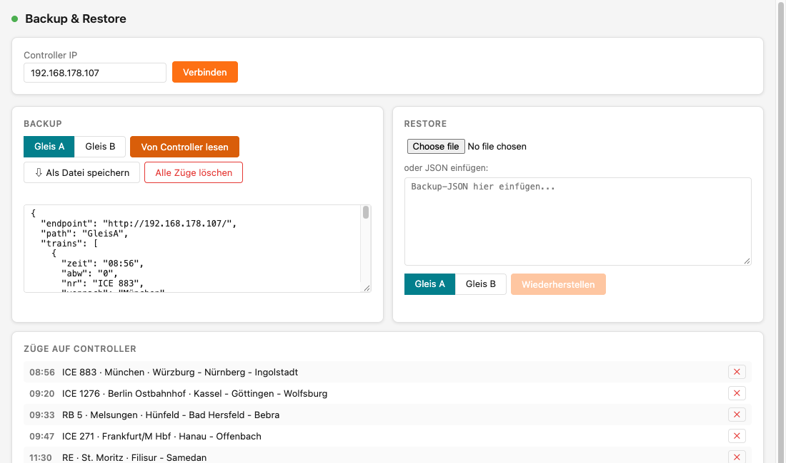
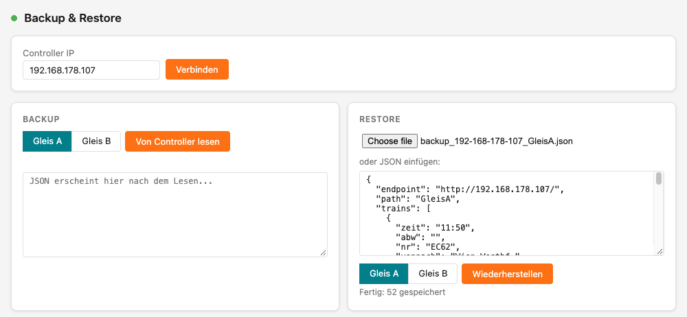
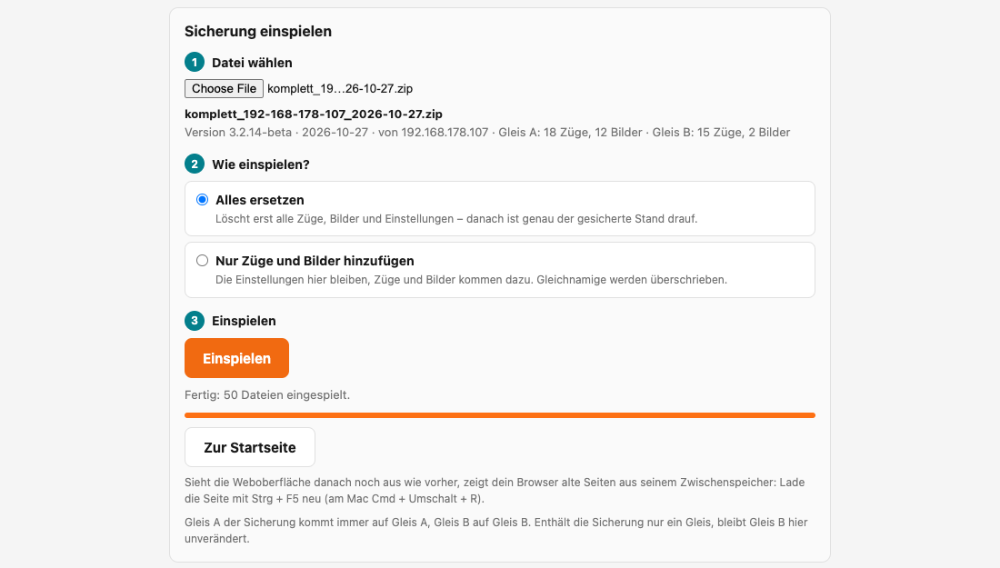

# Sichern und wiederherstellen

Für das Sichern gibt es zwei Werkzeuge. Beide findest du im Menü unten links (drei Striche), beide legen eine Datei auf deinem Computer ab und spielen sie bei Bedarf wieder ein.

| | Nur Zugdaten | Komplettes Backup |
|---|---|---|
| Menüeintrag | **Züge Backuptool** | **Komplett-Backup** |
| Was in der Datei steckt | die Zugliste **eines** Gleises | Züge, Bilder und Einstellungen **aller** Gleise |
| Datei | eine `.json`-Datei je Gleis | eine `.zip`-Datei für den ganzen Anzeiger |
| Ab Version | alle 3.x-Versionen | 3.2.14 |
| Typischer Anlass | Zugliste aufheben, Züge auf ein anderes Gleis übertragen | vor einem Update alles sichern und danach zurückholen |

Willst du nach einem Update alles wieder so haben wie vorher, nimm das **Komplette Backup**. Geht es nur um die Züge eines Gleises, reicht das **Züge Backuptool**.

## Inhalt
{: .no_toc .text-delta }

- TOC
{:toc}

---

## Nur Zugdaten — Züge Backuptool

Das Züge Backuptool sichert die Zugliste eines Gleises in eine Datei auf deinem Computer und spielt sie bei Bedarf wieder ein.

### Was das Backuptool sichert — und was nicht

Gesichert wird die **Zugliste** eines Gleises — also alle Züge mit Zeit, Zugnummer, Ziel, Via, Hinweis, Wagenreihung und DCC-Adresse.

**Nicht** gesichert werden:

- deine **Bilder**
- die **Einstellungen** des Gleises (Anzeigeart, Gleisnummer, Intervall-Zeit, MQTT und so weiter)
- die **WLAN-Zugangsdaten**

Die Einstellungen sind schnell wieder eingetragen — die Zugliste nicht. Deshalb sichert das Tool genau die. Alles zusammen sichert ab Version 3.2.14 das [Komplette Backup](#komplettes-backup--alles-in-einer-datei). Bei älteren Versionen sicherst du den Rest [von Hand](#einstellungen-und-bilder-von-hand-sichern-bis-version-3213).

> **Wichtig:** Sichere deine Zugliste **bevor** du ein Update des Dateisystems einspielst. Ein solches Update überschreibt Zugdateien, Bilder und Einstellungen.

### Das Backuptool öffnen

Klicke unten links auf das **Menü-Symbol** (drei Striche) und wähle **Züge Backuptool**.

Das Backuptool verbindet sich von selbst mit dem Anzeiger, von dem die Seite kommt: Oben bei **Controller IP** steht schon seine Adresse, der Punkt neben **Backup & Restore** leuchtet grün und unten steht **Verbunden mit …**.

{: style="max-width: 80%;" }

> **Hinweis:** Bis Version 3.2.12 musst du die **IP-Adresse** zuerst von Hand eintragen: Gib sie oben bei **Controller IP** ein und klicke auf **Verbinden**. Erst danach lassen sich die Knöpfe darunter benutzen.

Bei der Ausführung für **ein Gleis** gibt es nur **Gleis A**. Wählst du dort **Gleis B**, meldet das Backuptool **Controller nicht erreichbar** — schalte dann zurück auf **Gleis A**.

### Eine Sicherung erstellen

1. Wähle im Bereich **BACKUP** aus, welches Gleis du sichern willst — **Gleis A** oder **Gleis B**
2. Klicke auf **Von Controller lesen**. Das Backuptool liest jetzt jeden Zug einzeln — bei vielen Zügen dauert das einige Sekunden. Am Ende steht unten zum Beispiel **18 Züge geladen**
3. Erst jetzt erscheinen neben dem Knopf die Knöpfe **⇩ Als Datei speichern** und **Alle Züge löschen**. Im Feld darunter stehen deine Zugdaten, ganz unten die Liste **Züge auf Controller**
4. Klicke auf **⇩ Als Datei speichern**

{: style="max-width: 80%;" }

Die Datei landet im Download-Ordner deines Browsers — je nach Einstellung fragt der Browser vorher, wo du sie speichern willst. Ihr Name verrät, woher sie stammt: `backup_`, die IP-Adresse des Anzeigers, das Gleis und das Datum, zum Beispiel `backup_192-168-178-41_GleisA_2026-10-26.json`.

> **Tipp:** Du kannst die Datei danach umbenennen, zum Beispiel in `bahnhof-nord-gleisA-2026-10.json`. Das Backuptool liest beim Zurückspielen nur den Inhalt, der Name ist egal.

> **Hinweis:** Hast du zwei Gleise, brauchst du **zwei** Sicherungen — eine je Gleis.

### Eine Sicherung zurückspielen

1. Klicke im Bereich **RESTORE** auf **Datei auswählen** (je nach Browser auch **Choose file**) und wähle deine Sicherungsdatei. Ihr Inhalt erscheint im Textfeld darunter
2. Wähle darunter das Gleis aus, auf das die Züge sollen
3. Klicke auf **Wiederherstellen**. Das Backuptool zählt mit, welcher Zug gerade dran ist, und meldet am Ende zum Beispiel **Fertig: 52 gespeichert**

{: style="max-width: 80%;" }

Alternativ kannst du den Inhalt einer Sicherung auch direkt in das Textfeld einfügen, wenn du ihn zum Beispiel per Mail bekommen hast.

**Wiederherstellen** lässt sich erst anklicken, wenn das Backuptool verbunden ist und im Textfeld etwas steht.

> **Wichtig:** Achte darauf, das richtige Gleis auszuwählen. Spielst du eine Sicherung von Gleis A auf Gleis B ein, landen die Züge dort.

Das Zurückspielen **ergänzt** die Zugliste: Züge aus der Sicherung, die es auf dem Gleis schon gibt, werden überschrieben — alle anderen Züge auf dem Gleis bleiben stehen. Willst du genau den Stand aus der Sicherung, lösche vorher alle Züge des Gleises (siehe [Alle Züge löschen](#alle-züge-löschen)).

> **Hinweis:** Ein Gleis fasst höchstens **100 Züge**. Würden es mit der Sicherung mehr, nimmt der Anzeiger die übrigen nicht an und das Backuptool meldet am Ende **Fehler**.

### Alle Züge löschen

Der Knopf **Alle Züge löschen** räumt die komplette Zugliste des gewählten Gleises ab — praktisch, wenn du von vorn anfangen willst oder eine Sicherung ohne alte Reste zurückspielen möchtest.

Du findest den Knopf nicht sofort: Er erscheint im Bereich **BACKUP** erst, **nachdem du auf Von Controller lesen geklickt hast**. Gelöscht werden genau die Züge, die das Backuptool dabei gelesen hat.

1. Wähle das Gleis aus und klicke auf **Von Controller lesen**
2. Klicke auf **⇩ Als Datei speichern**, damit du eine Sicherung hast
3. Klicke auf **Alle Züge löschen** und bestätige die Rückfrage. Das Backuptool zählt mit und meldet am Ende **Alle Züge gelöscht**

Einzelne Züge löschst du in der Liste **Züge auf Controller** mit dem roten **✕** hinter dem Zug.

> **Wichtig:** Erst sichern, dann löschen. Rückgängig machen lässt sich das nicht.

### Züge auf einen anderen Anzeiger übertragen

Hast du mehrere Zugzielanzeiger und willst dieselben Züge auf allen haben:

1. Sichere die Zugliste des ersten Anzeigers wie oben beschrieben
2. Öffne das Backuptool des zweiten Anzeigers — oder trage oben einfach dessen **IP-Adresse** ein und klicke auf **Verbinden**
3. Spiele die Datei dort ein

Die Sicherung lässt sich auch auf ein anderes Gleis zurückspielen: Wähle unter **RESTORE** einfach das Ziel-Gleis.

So kannst du auch einen Bahnsteig mit zwei Gleisen schnell gleich bestücken und danach nur noch die Abweichungen von Hand ändern.

---

## Komplettes Backup — alles in einer Datei

Das **Komplett-Backup** gibt es ab Version **3.2.14**. Es sichert alles, was du auf dem Anzeiger eingerichtet hast, in **eine** Datei — und spielt sie mit wenigen Klicks wieder ein. Danach sieht der Anzeiger aus wie zum Zeitpunkt der Sicherung.

### Was im Komplett-Backup steckt — und was nicht

In der Datei stecken:

- die **Zuglisten** aller Gleise
- deine **Bilder** aller Gleise
- die **Einstellungen** der Gleise (Anzeigeart, Gleisnummer, Intervall-Zeit und so weiter)
- die **Geräte-Einstellungen** wie Geräte-ID und MQTT-Zugang

**Nicht** in der Datei sind:

- die **Weboberfläche** selbst — sie kommt immer mit der Firmware. So bringt das Zurückspielen nach einem Update nicht die alten Seiten zurück
- die **WLAN-Zugangsdaten**, die **Helligkeit** und die übrigen Einstellungen der [Hintergrundbeleuchtung](../allgemein/hintergrundbeleuchtung.md) — die bleiben bei einem Update ohnehin erhalten

> **Wichtig:** In der Datei steht auch dein **MQTT-Passwort**, falls du eines eingetragen hast. Gib die Datei deshalb nicht einfach weiter.

### Komplett-Backup öffnen

Klicke unten links auf das **Menü-Symbol** (drei Striche) und wähle **Komplett-Backup** — es steht direkt unter **Züge Backuptool**. Oben zeigt die Seite die installierte **Version**, darunter fragt sie **Was möchtest du tun?**

### Alles sichern

1. Klicke auf **Alles sichern**
2. Der Browser lädt jetzt jede Datei einzeln vom Anzeiger, der Balken zeigt den Fortschritt. Bei vielen Bildern dauert das etwas
3. Am Ende steht zum Beispiel **✓ Gesichert: Gleis A: 18 Züge, 12 Bilder · Gleis B: 15 Züge, 2 Bilder und die Einstellungen.**

{: style="max-width: 80%;" }

Die Datei landet im Download-Ordner deines Browsers — je nach Einstellung fragt der Browser vorher, wo du sie speichern willst. Ihr Name verrät, woher sie stammt: `komplett_`, die IP-Adresse des Anzeigers und das Datum, zum Beispiel `komplett_192-168-178-41_2026-10-27.zip`.

Es ist eine gewöhnliche **ZIP-Datei** — ein Paket, das mehrere Dateien zusammenfasst. Mit einem Doppelklick kannst du hineinschauen, unter Windows wie am Mac. Zum Zurückspielen brauchst du aber die ZIP-Datei selbst, nicht den ausgepackten Ordner.

> **Tipp:** Du kannst die Datei umbenennen, zum Beispiel in `bahnhof-nord-2026-10.zip`. Beim Zurückspielen zählt nur der Inhalt.

### Sicherung einspielen

1. Klicke auf **Sicherung einspielen**
2. Klicke unter **Datei wählen** auf **Datei auswählen** (je nach Browser auch **Choose File**) und wähle deine ZIP-Datei. Darunter zeigt die Seite, was in der Sicherung steckt: Version, Datum, von welchem Anzeiger sie stammt und wie viele Züge und Bilder je Gleis
3. Wähle unter **Wie einspielen?**, was passieren soll (siehe unten)
4. Klicke auf **Einspielen** und bestätige die Rückfrage
5. Die Seite überträgt jetzt Datei für Datei. Danach startet der Anzeiger neu, die Seite wartet darauf. Lass den Tab so lange offen
6. Am Ende steht zum Beispiel **Fertig: 50 Dateien eingespielt.** und darunter der Knopf **Zur Startseite**

{: style="max-width: 80%;" }

Du hast zwei Möglichkeiten:

- **Alles ersetzen** — löscht erst alle Züge, Bilder und Einstellungen auf dem Anzeiger. Danach ist genau der gesicherte Stand drauf, nichts sonst. Das ist die richtige Wahl nach einem Update
- **Nur Züge und Bilder hinzufügen** — die Einstellungen auf dem Anzeiger bleiben, wie sie sind. Züge und Bilder aus der Sicherung kommen dazu, alles Vorhandene bleibt stehen. Gibt es einen Zug oder ein Bild mit demselben Dateinamen schon, wird es überschrieben. So holst du dir zum Beispiel Züge und Bilder von einem anderen Anzeiger

{: style="max-width: 80%;" }

> **Wichtig:** **Alles ersetzen** lässt sich nicht rückgängig machen. Bist du unsicher, mach vorher mit **Alles sichern** eine Sicherung vom jetzigen Stand.

Gleis A der Sicherung kommt immer auf Gleis A, Gleis B auf Gleis B. Ein anderes Gleis als Ziel kannst du hier nicht wählen — dafür gibt es das [Züge Backuptool](#züge-auf-einen-anderen-anzeiger-übertragen).

Bevor die Seite etwas ändert, prüft sie, ob alles passt. Hätte ein Gleis danach mehr als **100 Züge** oder reicht der Speicherplatz auf dem Anzeiger nicht, bricht sie mit einer Meldung ab — unten steht dann **Nichts geändert.**

Sieht die Weboberfläche nach dem Einspielen noch aus wie vorher, zeigt dein Browser alte Seiten aus seinem Zwischenspeicher. Lade die Seite dann ohne Zwischenspeicher neu, siehe [Nach dem Update: Seite neu laden](../allgemein/controller-aktualisieren-wlan.md#nach-dem-update-seite-neu-laden).

### Anzeiger mit einem Gleis

Beim Anzeiger für **ein Gleis** gibt es nur **Gleis A**. Die Seite spricht dort von „diesem Controller“ statt von einzelnen Gleisen.

Stammt die Sicherung von einem Anzeiger mit **zwei** Gleisen, spielt die Seite nur **Gleis A** ein. Das zeigt sie schon nach dem Auswählen der Datei an: **Gleis B der Sicherung wird weggelassen – dieser Controller hat nur ein Gleis.**

Umgekehrt geht es auch: Spielst du die Sicherung eines Anzeigers mit einem Gleis auf einen mit zwei Gleisen, ändert sich nur **Gleis A**. Gleis B bleibt, wie es ist — auch bei **Alles ersetzen**.

### Nach einem Update alles zurückholen

Hast du schon Version 3.2.14 oder neuer, nimmt dir die Seite **Firmware-Update** das Sichern ab: In Schritt 1 legt **Alles sichern** genau diese ZIP-Datei an. Nach dem Update führt dich der Knopf **Sicherung einspielen** direkt hierher. Wie das im Einzelnen geht, steht unter [Controller aktualisieren](../allgemein/controller-aktualisieren-wlan.md#weg-1-firmware-update-aus-dem-internet).

Aktualisierst du auf einem anderen Weg, zum Beispiel mit heruntergeladenen Dateien:

1. Vor dem Update: **Komplett-Backup** öffnen und **Alles sichern**
2. Das Update einspielen
3. Danach: **Komplett-Backup** öffnen, die Datei auswählen, **Alles ersetzen** und **Einspielen**

Damit sind Züge, Bilder und Einstellungen wieder da — du musst nichts von Hand eintragen.

---

## Einstellungen und Bilder von Hand sichern (bis Version 3.2.13)

Ab Version 3.2.14 nimmt dir das [Komplette Backup](#komplettes-backup--alles-in-einer-datei) diese Arbeit ab. Bei älteren Versionen sicherst du Einstellungen und Bilder so von Hand.

In zwei Fällen ist alles weg, was nicht in der Zugsicherung steckt:

- Beim **Update des Dateisystems** über die Upgrade-Seite werden Zugdateien und Bilder überschrieben.
- Ist das Dateisystem nach einem Stromausfall beschädigt, **formatiert sich der Controller selbst** und startet sauber. Er läuft danach wieder, ist aber leer.

Beides passiert selten, aber es lohnt sich, vorbereitet zu sein.

### Die Einstellungen sichern

Ruf im Browser die Adresse deines Anzeigers auf, ergänzt um `/GleisA/config.json` — also zum Beispiel `192.168.178.41/GleisA/config.json`. Du siehst dann die Einstellungen dieses Gleises als Text. Speichere die Seite über das Menü deines Browsers als Datei ab. Hat dein Anzeiger zwei Gleise, machst du dasselbe noch einmal mit `/GleisB/config.json`.

> **Hinweis:** Diese Datei lässt sich nicht zurückspielen. Sie dient zum Nachschlagen — die Werte trägst du im Bedarfsfall von Hand wieder in das Konfigurationsfenster ein.

**Einfacher geht es so:** Öffne das Konfigurationsfenster mit dem Zahnrad **⚙** und mach ein Bildschirmfoto davon. Bei zwei Gleisen je eines. Das reicht für den Notfall völlig und du musst dich mit keiner Datei befassen.

### Die Bilder sichern

Schalte in der Kachel auf **Bilder** um. Klicke dann mit der rechten Maustaste auf ein Vorschaubild und wähle **Bild speichern unter** — die Vorschau ist die Originaldatei. Das wiederholst du für jedes Bild, das du behalten willst.

> **Tipp:** Am einfachsten ist es, die Bilder ohnehin dort aufzubewahren, wo du sie erstellt hast. Dann brauchst du sie gar nicht erst herunterzuladen.

---

## Problembehebung

| Problem | Lösung |
|---|---|
| Die Knöpfe sind ausgegraut | Prüfe, ob der Punkt neben **Backup & Restore** grün ist. Wenn nicht: Trage oben die **Controller IP** ein und klicke auf **Verbinden** |
| **Wiederherstellen** ist ausgegraut, obwohl die Datei geladen ist | Das Backuptool ist nicht verbunden. Klicke oben auf **Verbinden** |
| Der Knopf **Alle Züge löschen** fehlt | Er erscheint erst, nachdem du **Von Controller lesen** geklickt hast |
| Unten steht **Controller nicht erreichbar**, obwohl die IP stimmt | Beim Anzeiger für ein Gleis ist **Gleis B** gewählt. Schalte auf **Gleis A** |
| Nach dem Wiederherstellen sind noch alte Züge da | Das Zurückspielen ergänzt nur. Lösche vorher alle Züge des Gleises, siehe [Alle Züge löschen](#alle-züge-löschen) |
| **Von Controller lesen** bringt nichts | Prüfe, ob die IP-Adresse stimmt und der Anzeiger eingeschaltet ist |
| Nach dem Wiederherstellen fehlen Züge | Prüfe, ob das richtige Gleis ausgewählt war |
| Züge Backuptool: Meine Bilder sind nach dem Wiederherstellen weg | Bilder sind nicht Teil dieser Sicherung — das [Komplette Backup](#komplettes-backup--alles-in-einer-datei) nimmt sie mit. Lade sie neu hoch — siehe [Bilder statt Züge anzeigen](bilder-anzeigen.md) |
| Züge Backuptool: Die Einstellungen stimmen nicht mehr | Auch die sind nicht Teil dieser Sicherung. Trage sie über das Zahnrad **⚙** neu ein |
| Nach einem Firmware-Update sind alle Züge weg | Das passiert beim Update des Dateisystems. Spiele deine Sicherung wieder ein |
| **Komplett-Backup** fehlt im Menü | Das Komplett-Backup gibt es ab Version 3.2.14. Aktualisiere den Anzeiger, siehe [Controller aktualisieren](../allgemein/controller-aktualisieren-wlan.md). Ist die Version schon neu, lade die Seite ohne Zwischenspeicher neu (Strg + F5) |
| Komplett-Backup: **Einspielen** bricht ab, unten steht **Nichts geändert.** | Die Vorab-Prüfung hat etwas gefunden, die Meldung steht über dem Balken: mehr als 100 Züge auf einem Gleis oder zu wenig Speicherplatz. Mit **Alles ersetzen** statt **Nur Züge und Bilder hinzufügen** wird vorher Platz frei |
| Komplett-Backup: Die Seite meldet, die Datei sei **keine Komplett-Sicherung** | Wähle die ZIP-Datei, die **Alles sichern** angelegt hat — nicht eine `.json`-Datei aus dem Züge Backuptool und nicht den ausgepackten Ordner |
| Komplett-Backup: Am Ende steht **Nicht eingespielt:** mit einer Liste von Dateien | Der Anzeiger wurde trotzdem neu gestartet. Spiel die Sicherung noch einmal mit **Alles ersetzen** ein |
| Komplett-Backup: **Der Controller meldet sich nicht** | Warte einen Moment und öffne dann die Startseite. Drücke sonst kurz **BTN 0** am Controller — das Display zeigt die IP-Adresse |
