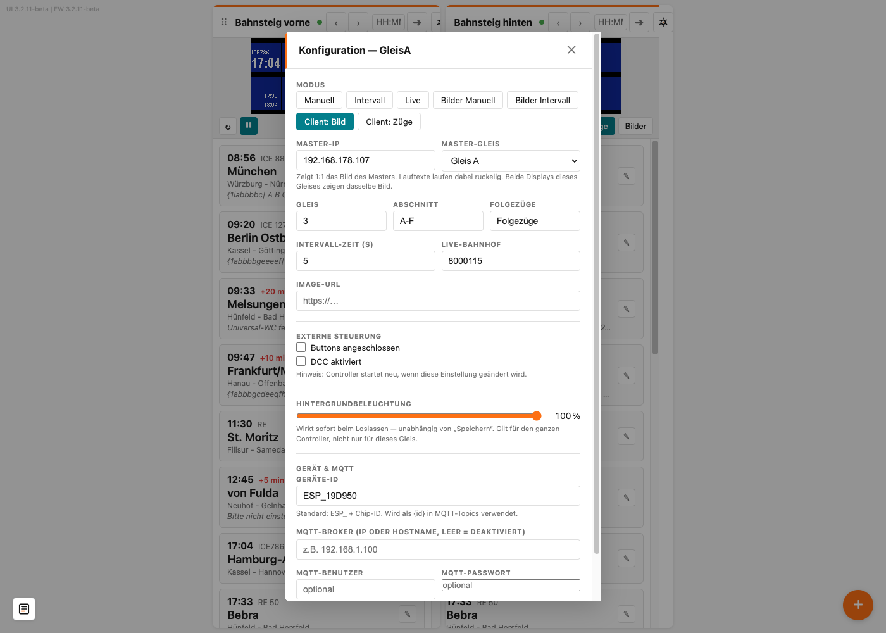
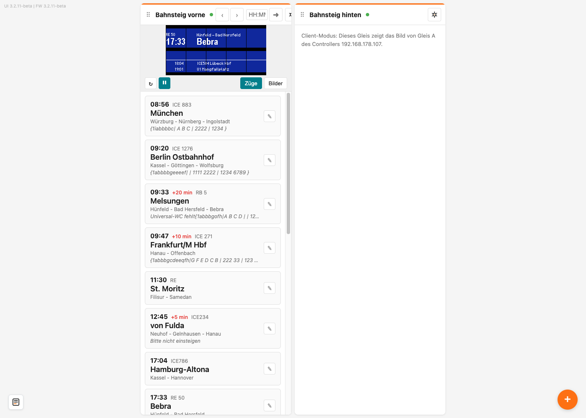

# Zwei Anzeiger gleich schalten (Client-Modus)

Mit dem Client-Modus zeigt ein Gleis genau das, was ein Gleis auf einem **anderen Controller** zeigt — zum Beispiel, wenn ein langer Bahnsteig an beiden Enden einen Zugzielanzeiger bekommt, die beiden aber an verschiedenen Controllern hängen. Du pflegst die Züge dann nur an einem Controller, der andere zieht von selbst nach.

> **Gilt für:** Den Client-Modus gibt es ab Firmware **3.2.11**. Beide Controller brauchen diese oder eine neuere Version.

## Inhalt
{: .no_toc .text-delta }

- TOC
{:toc}

---

## Master und Client

Die beiden Controller haben dabei verschiedene Rollen:

- Der **Master** (englisch für „Meister“) ist der Controller, den du ganz normal bedienst. Dort legst du die Züge an, schaltest weiter oder lässt ihn im Intervall laufen. An ihm änderst du nichts.
- Der **Client** (englisch für „Kunde“) ist der Controller, der nachmacht. Bei ihm stellst du eines seiner Gleise auf eine der beiden Client-Anzeigearten und trägst ein, von welchem Master er seine Anzeige holen soll.

Eingestellt wird das **pro Gleis**. Beim Zugzielanzeiger für zwei Gleise kann also Gleis A ein Client sein und Gleis B ganz normal eigene Züge zeigen.

> **Hinweis:** Beide Controller müssen im **selben WLAN** sein. Der Client fragt den Master über das WLAN ab — ohne Verbindung zum Master bekommt er nichts zu sehen.

 OFFEN-28: Typischer Einsatzfall — stimmt das Beispiel „langer Bahnsteig, beide Enden, zwei Controller“? Oder eher: mehr Displays an einem Gleis, als ein Controller ansteuern kann? 

---

## Die beiden Client-Anzeigearten

| Anzeigeart | Was sie macht | Gut für |
|---|---|---|
| **Client: Bild** | Zeigt 1:1 das fertige Bild des Masters — egal ob Züge, Bilder oder eine Wagenreihung | Wenn beide Anzeiger wirklich **genau gleich** aussehen sollen, auch in den Bild-Anzeigearten |
| **Client: Züge** | Übernimmt nur die drei Züge vom Master und zeichnet sie selbst | Wenn Lauftexte **flüssig** laufen sollen |

**Client: Bild** überträgt das Bild immer wieder neu. Deshalb laufen Lauftexte am Client ruckelig. Außerdem zeigt der Client auf **Vorder- und Rückseite** dasselbe, nämlich die **Vorderseite** des Masters. Das fällt nur bei Bildern auf, die vorn und hinten verschieden sind (siehe [Wie das Bild auf Vorder- und Rückseite kommt](bilder-anzeigen.md#wie-das-bild-auf-vorder--und-rückseite-kommt)): Die Rückseite des Masters ist am Client dann nicht zu sehen.

**Client: Züge** zeichnet selbst, Lauftexte laufen flüssig — aber nicht genau gleichzeitig mit dem Master. Der Master überträgt die drei angezeigten Züge vollständig — mit Zeit, Ziel, Hinweis und Wagenreihung. Am Client musst du deshalb **keine Züge anlegen**; was dort in der Zugliste steht, spielt keine Rolle.

> **Tipp:** Weißt du nicht, welche du nehmen sollst, fang mit **Client: Bild** an. Damit zeigt der Client alles, was der Master zeigt — auch Bilder. Stören dich die ruckeligen Lauftexte, wechsle zu **Client: Züge**.

> **Hinweis:** Zeigt der Master Bilder statt Zügen, behält ein Client im Modus **Client: Züge** die zuletzt übertragenen Züge auf dem Display.

---

## Den Client einrichten

Am **Master** musst du nichts einstellen. Du brauchst nur seine Adresse. Die siehst du, wenn du am Master kurz **BTN 0** drückst (siehe [IP-Adresse herausfinden](../allgemein/wlan-einrichten.md#ip-adresse-herausfinden)), oder oben in der Adressleiste, wenn du seine Weboberfläche geöffnet hast.

Dann öffnest du die Weboberfläche des **Clients**:

1. Klicke im Kopf der Kachel des Gleises, das nachmachen soll, auf das Zahnrad **⚙**.
2. Wähle unter **Modus** die Anzeigeart **Client: Bild** oder **Client: Züge**. Darunter erscheinen zwei neue Felder.
3. Trage bei **Master-IP** die Adresse des Masters ein, zum Beispiel `192.168.178.107` — nur die Zahlen, ohne `http://`.
4. Wähle bei **Master-Gleis**, welches Gleis des Masters übernommen werden soll: **Gleis A** oder **Gleis B**. Hat der Master nur ein Gleis, ist es **Gleis A**.
5. Klicke unten auf **Speichern**.



Nach ein bis zwei Sekunden zeigt der Client dasselbe wie der Master. Ein Neustart ist nicht nötig.

> **Wichtig:** Trag bei **Master-IP** die Adresse des **anderen** Controllers ein. Die eigene Adresse lehnt die Weboberfläche ab.

> **Hinweis:** Die Adresse eines Controllers kann sich ändern, etwa nach einem Neustart des Routers. Damit der Client seinen Master zuverlässig findet, lohnt es sich, dem Master in deinem Router eine **feste IP-Adresse** zu geben. Wie das geht, steht in der Anleitung deines Routers — bei der FRITZ!Box heißt die Einstellung „Diesem Netzwerkgerät immer die gleiche IPv4-Adresse zuweisen“.

 OFFEN-30: Router-Hinweis (feste IP) so drinlassen? Der FRITZ!Box-Wortlaut ist aus dem Gedächtnis, nicht an einem Gerät geprüft. 

---

## Im Betrieb

### Bedienen nur am Master

Weitergeschaltet wird **nur am Master** — von Hand, per Taster, über DCC, aus dem Steuerungsprogramm oder im Intervall. Der Client zieht innerhalb von Sekundenbruchteilen nach.

Am Client selbst haben Taster, DCC-Befehle und die Knöpfe **‹** und **›** für dieses Gleis keine Wirkung.

### Die Kachel des Clients

In der Weboberfläche des Clients zeigt die Kachel kein Vorschaubild und keine Zugliste mehr. Stattdessen steht dort, von welchem Controller und Gleis die Anzeige kommt:



Was auf dem Client zu sehen ist, siehst du also in der Kachel des **Masters**. Willst du beide Kacheln nebeneinander haben, füge den Master mit dem runden **+** unten rechts als weiteres Display hinzu.

### Wenn der Master nicht erreichbar ist

Ist der Master ausgeschaltet oder nicht im WLAN, zeigt ein Client im Modus **Client: Bild** nach etwa fünf Sekunden auf dem Display:

```
Client: warte auf
192.168.178.107 / A
```

Darunter stehen die eingetragene Adresse und das Gleis des Masters. Sobald der Master wieder da ist, verbindet sich der Client von selbst, und das Bild kommt zurück.

Im Modus **Client: Züge** bleiben die zuletzt übertragenen Züge stehen, bis der Master wieder erreichbar ist.

 OFFEN-31: Verhalten bei Client: Züge ohne Master nur aus dem Code/der Spec abgeleitet (letzte Züge bleiben), nicht am Gerät beobachtet. 

---

## Was nicht geht

- **Client von einem Client:** Ein Gleis, das selbst im Client-Modus steht, liefert kein Bild weiter. Trage als Master deshalb immer den Controller ein, an dem die Züge wirklich gepflegt werden.
- **Verschiedene Displaygrößen bei Client: Bild:** Das Bild wird 1:1 übertragen. Master und Client brauchen deshalb Displays derselben Größe.

 OFFEN-32: Gilt der Client-Modus auch für die älteren Anzeiger mit 0,96"-Displays (S2 Mini)? Die Kapitel-Übersicht schließt sie ohnehin aus — reicht das? 

---

## Zurück zum normalen Betrieb

Öffne am Client wieder die Einstellungen des Gleises, wähle eine der normalen Anzeigearten — zum Beispiel **Manuell** oder **Intervall** — und klicke auf **Speichern**. Das Gleis zeigt dann wieder seine eigenen Züge. Die eingetragene Master-IP bleibt gespeichert, falls du später zurückwechseln willst.

---

## Problembehebung

| Problem | Lösung |
|---|---|
| Auf dem Client steht **Client: warte auf** | Der Client erreicht den Master nicht. Prüfe, ob der Master eingeschaltet und im selben WLAN ist und ob die **Master-IP** noch stimmt — drücke dazu am Master kurz **BTN 0** |
| Die Master-IP stimmt nach ein paar Tagen nicht mehr | Der Router hat dem Master eine neue Adresse gegeben. Gib dem Master im Router eine feste IP-Adresse und trage sie am Client ein |
| Beim Speichern erscheint **Der Master muss ein anderer Controller sein als dieser** | Du hast die eigene Adresse eingetragen. Trage die Adresse des anderen Controllers ein |
| Beim Speichern erscheint **Bitte die IP-Adresse des Masters eintragen** | Das Feld **Master-IP** ist leer |
| Lauftexte laufen am Client ruckelig | Das ist bei **Client: Bild** so. Nimm **Client: Züge**, wenn der Master Züge zeigt |
| **‹**, **›**, Taster oder DCC tun am Client nichts | Das ist so. Im Client-Modus wird nur am Master geschaltet |
| Die Kachel des Clients zeigt kein Bild | Das ist so. Das Bild siehst du in der Kachel des Masters |
